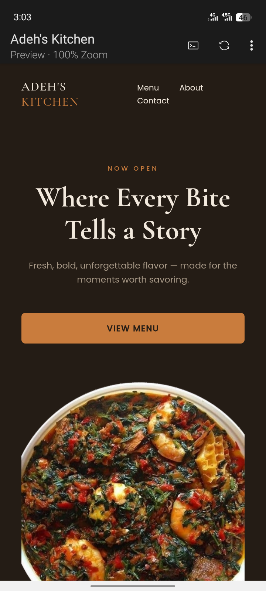

# Adeh's Kitchen

A restaurant landing page with a filterable menu and WhatsApp ordering, plus a table reservation system — built with HTML, CSS, and JavaScript.

## Preview

## Links

Solution link: [https://github.com/DevAdeh/Adeh-s-Kitchen-.git]

Live link: [https://adehs-kitchen.vercel.app/]

## Features
- Menu filtering by category (Rice, Soups, Grills, Small Chops, Catering)
- "Order Now" button that opens WhatsApp with a pre-filled message
- Dedicated table reservation page with date, time, and guest count
- Form validation with inline error states
- Booking confirmation screen with reservation details

## How it works
The menu page renders food items dynamically from an array of objects, filtered by category using `.filter()`. Ordering opens a WhatsApp chat link pre-filled with the item name. The reservation page validates each field before allowing submission, builds a dynamic list of available time slots, and displays a formatted confirmation once a booking is successfully made.

## Tech used
- HTML
- CSS
- JavaScript (DOM rendering, form validation, date/time handling)

## How to use
1. Clone or download this repo
2. Open `index.html` to browse the menu and place an order
3. Open `reserve.html` to book a table

## Project structure

adehs-kitchen/
├── index.html
├── reserve.html
├── style.css
├── script.js
├── reserve.js
├── assets/
└── README.md

## Author
Adeola Ejikunle — [GitHub](https://github.com/DevAdeh)